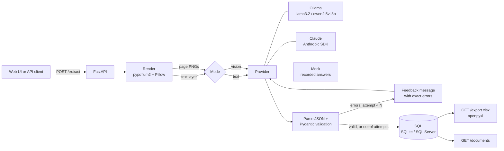

# AI Document Extraction Pipeline

Turns invoice and purchase order PDFs or scans into validated JSON, SQL rows and Excel,
using a local LLM, Pydantic schema checks and an automatic retry that feeds the
validation errors back to the model.

[](https://github.com/sahil-ambekarr/ai-document-extraction-pipeline/actions/workflows/ci.yml)
[](LICENSE)


<!-- SCREENSHOTS -->

## The problem it automates

Accounts payable and purchasing teams retype the same fields from every invoice and
purchase order: vendor, buyer, number, dates, currency, each line item, subtotal, tax
and total. An LLM can read these documents, but its output cannot be trusted blindly:
small models drop lines, confuse the tax rate with the tax amount, or misread a date.

This service makes the model's answer checkable. Each extraction is validated against a
schema with arithmetic rules (lines add up to the subtotal, subtotal + tax = total,
amount = quantity x unit price, sane dates). When a rule fails, the model gets its own
answer back with the exact errors and tries again. Every attempt is stored, so a person
can see what was fixed and what still needs review.

This is a portfolio project. It has not been used in production, and all sample
documents are synthetic with fictional company names.

## Architecture



## Features

- **Two extraction modes.** `text` sends the PDF text layer to a text model; `vision`
  sends page images to a vision model; `auto` picks text when the PDF has a real text
  layer and vision for scans and photos. Set by `EXTRACTION_MODE` or per request.
- **Schemas with cross-field rules** for `Invoice` and `PurchaseOrder`
  (`app/schemas.py`), selected by a `document_type` discriminator.
- **Validation-driven retry.** Up to `MAX_ATTEMPTS` attempts; each retry includes the
  previous answer and the error list with field paths such as `line_items.2.amount`.
- **Provider abstraction:** `ollama` (default), `claude` (vision through the Anthropic
  SDK) and `mock` (replays recorded model answers keyed by the file's SHA-256).
- **Storage and export.** SQLAlchemy models for documents and line items; SQLite by
  default, any SQLAlchemy URL via `DATABASE_URL`. Excel export with a documents sheet
  and a line items sheet.
- **Web UI** (plain HTML and JS, served by FastAPI): upload, page preview beside the
  JSON, validation status and retry count, Excel download, list of stored documents.
- **API with OpenAPI docs** at `/docs`: `POST /extract`, `GET /documents`,
  `GET /documents/{id}`, `GET /documents/{id}/pages/{n}`, `GET /export.xlsx`, `GET /health`.
- **Labelled synthetic dataset** of 18 documents from a seeded generator, and an eval
  script that reports field accuracy, line-item F1, schema-valid rate, retries and latency.
- Upload guards: magic-byte file sniffing, size limit, page limit; timeouts and
  backoff on model calls; JSON-lines logging.

## Tech stack

Python 3.14, FastAPI, Pydantic 2, SQLAlchemy 2, openpyxl, pypdfium2, Pillow, httpx,
Anthropic Python SDK, Ollama (llama3.2 3B, qwen2.5vl 3B), reportlab (sample generation),
Playwright (screenshots), pytest, ruff, GitHub Actions.

## Quick start

Needs Python 3.14 (3.11+ should work but was not tested) and, for real extraction,
[Ollama](https://ollama.com) running locally.

Windows (PowerShell):

```powershell
git clone https://github.com/sahil-ambekarr/ai-document-extraction-pipeline.git
cd ai-document-extraction-pipeline
py -3.14 -m venv .venv
.venv\Scripts\Activate.ps1
pip install -r requirements-dev.txt
copy .env.example .env
ollama pull llama3.2
ollama pull qwen2.5vl:3b        # optional, for vision mode (about 3.2 GB)
python -m app.main               # http://127.0.0.1:4102
```

macOS / Linux:

```bash
git clone https://github.com/sahil-ambekarr/ai-document-extraction-pipeline.git
cd ai-document-extraction-pipeline
python3.14 -m venv .venv && source .venv/bin/activate
pip install -r requirements-dev.txt
cp .env.example .env
ollama pull llama3.2 && ollama pull qwen2.5vl:3b
python -m app.main               # http://127.0.0.1:4102
```

Try it without any model: set `LLM_PROVIDER=mock` in `.env` and upload a file from
`data/samples/`. The mock provider replays answers that llama3.2 actually gave for that
file during the eval run.

Call the API directly:

```bash
curl -F "file=@data/samples/inv-002-banded.pdf" -F "mode=text" http://127.0.0.1:4102/extract
curl -o extractions.xlsx http://127.0.0.1:4102/export.xlsx
```

Docker (`docker compose up --build`) starts the API and an Ollama container, with an
optional `sqlserver` profile. **Docker is not verified locally**: the build machine has
no Docker.

## Configuration

All settings are environment variables; `.env` in the repo root is read at start-up.

| Variable | Default | Meaning |
|---|---|---|
| `LLM_PROVIDER` | `ollama` | `ollama`, `claude` or `mock` |
| `EXTRACTION_MODE` | `auto` | `auto`, `text` or `vision`; the `mode` form field overrides it per request |
| `MAX_ATTEMPTS` | `3` | Total attempts per document, including the first (1 = no retry) |
| `OLLAMA_BASE_URL` | `http://localhost:11434` | Ollama server |
| `OLLAMA_TEXT_MODEL` | `llama3.2` | Model for text mode |
| `OLLAMA_VISION_MODEL` | `qwen2.5vl:3b` | Model for vision mode |
| `LLM_TIMEOUT_SECONDS` | `900` | Read timeout for one model call (CPU inference is slow) |
| `ANTHROPIC_API_KEY` | empty | Required when `LLM_PROVIDER=claude` |
| `CLAUDE_MODEL` | `claude-haiku-5-5` | Claude model for both modes |
| `MOCK_RESPONSES_DIR` | `data/mock_responses` | Recordings for the mock provider |
| `DATABASE_URL` | `sqlite:///var/extraction.db` | Any SQLAlchemy URL; SQL Server via `mssql+pyodbc://...` (not verified locally) |
| `STORAGE_DIR` | `var/pages` | Where page previews are stored |
| `MAX_PAGES` | `4` | Pages rendered and sent per document |
| `MAX_UPLOAD_MB` | `15` | Upload size limit |
| `VISION_MAX_SIDE` | `1280` | Long side, in pixels, of page images sent to vision models |
| `PORT` | `4102` | Port for `python -m app.main` |

| Provider | What it needs | Status |
|---|---|---|
| `ollama` | Local Ollama with the models pulled | Used for every eval number below |
| `claude` | `ANTHROPIC_API_KEY` | Unit-tested against a stubbed HTTP layer only; **not verified against the live API** |
| `mock` | Nothing | Replays recorded answers; used by tests, CI and the no-model demo |

## Eval results

<!-- EVAL -->

## Project structure

```
app/
  main.py            FastAPI app factory and routes
  schemas.py         Invoice / PurchaseOrder models and cross-field rules
  pipeline.py        extract -> validate -> feedback -> retry loop
  prompts.py         system prompt, text/vision prompts, retry message
  rendering.py       PDF/image sniffing, page rendering, text layer
  providers/         base interface + ollama, claude, mock
  storage.py         SQLAlchemy models and queries
  exporters.py       Excel workbook builder
  evaluation.py      metric functions used by scripts/eval.py
  api_models.py      response models (OpenAPI)
  static/            web UI (index.html, app.js, style.css)
scripts/
  generate_samples.py  seeded synthetic documents + labels
  eval.py              accuracy evaluation and report
  screenshots.py       Playwright screenshots of the running UI
data/
  samples/           18 synthetic PDFs and PNG scans
  labels/            ground-truth JSON, one per sample
  mock_responses/    recorded model outputs keyed by SHA-256
eval/results/        raw eval JSON per provider/model/mode
docs/                eval-results.md, screenshots
tests/               pytest suite
```

## Tests

```bash
pytest          # all tests, no model or network needed
ruff check .
```

<!-- TESTS -->

The suite covers schema rules (each cross-field check, tolerance, number parsing, date
sanity), the retry loop with a scripted provider that fails and then succeeds, giving up
after `MAX_ATTEMPTS`, rendering and upload guards, SQL storage and the Excel export,
the Ollama and Claude adapters against stubbed HTTP transports, the eval metric
functions, and every API endpoint in mock mode including 404, 413, 415, 422 and 502 paths.

CI (GitHub Actions) runs ruff, pytest and a mock-mode replay of the eval on Python 3.14.

## Key decisions

- **pypdfium2 instead of PyMuPDF.** It installed from a Python 3.14 wheel and is
  Apache-2.0/BSD licensed; PyMuPDF is AGPL. It does both jobs needed here: rendering and
  text extraction.
- **Validate, then retry with the errors.** JSON mode only guarantees valid syntax. The
  schema's arithmetic rules catch the mistakes small models actually make, and the
  error list gives the model something specific to fix.
- **Store invalid results too.** A document that is still invalid after the last attempt
  is saved with its errors and the last answer, but its typed SQL columns and line
  items stay empty, so downstream SQL only sees validated data.
- **Mock provider replays real recordings.** `scripts/eval.py --record` stores the raw
  llama3.2 answers per document and mode, so the mock demo and CI exercise real model
  output (including real retries) without a model.
- **Synthetic data only.** The generator is seeded and produces byte-identical files on
  re-run (checked locally on Windows), so the eval is reproducible and contains no
  real company data.
- **Sequential, long-timeout model calls.** The machine runs Ollama on CPU and shares it
  with other work; the eval sends one request at a time and allows 15 minutes per call.
- **No background job queue.** `POST /extract` blocks until the extraction finishes
  (run in a worker thread). Simple to follow; a queue would be the first change for
  real use.

## Roadmap

- Background jobs with polling for long extractions.
- Per-field confidence and a review queue for invalid or low-confidence documents.
- A larger, more varied eval set, including real documents shared with consent.
- Alembic migrations, and verifying the SQL Server path and Docker setup.
- Verify the Claude provider against the live API and add it to the eval table.

## License

MIT - see [LICENSE](LICENSE). Copyright (c) 2026 Sahil Ambekar.
